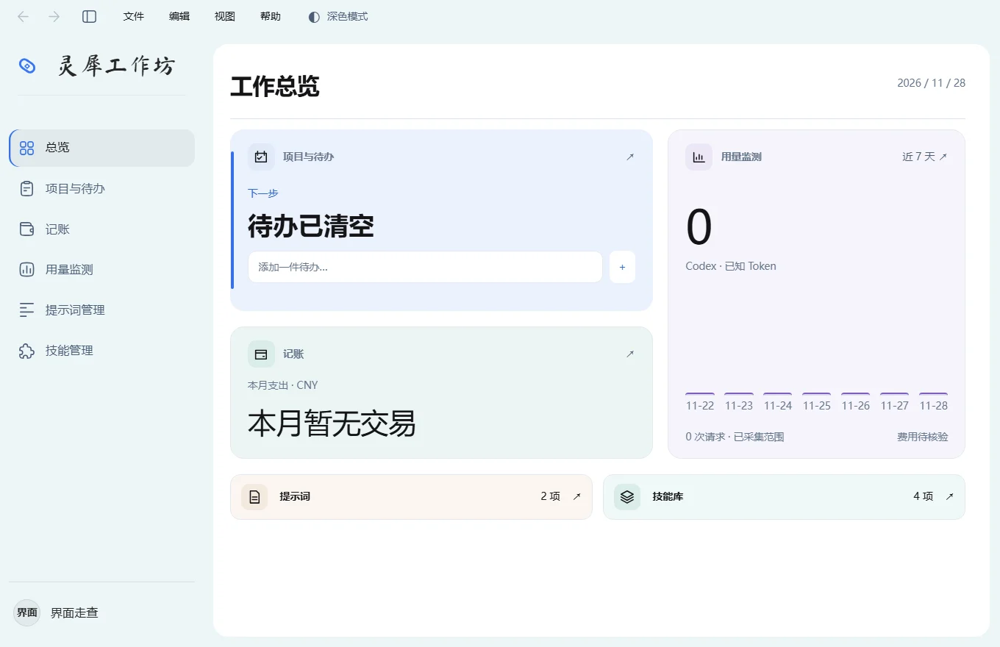
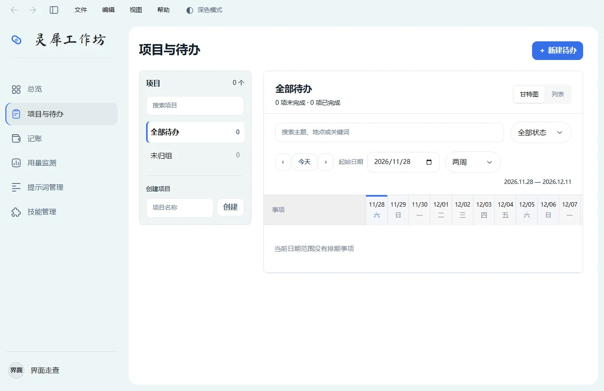
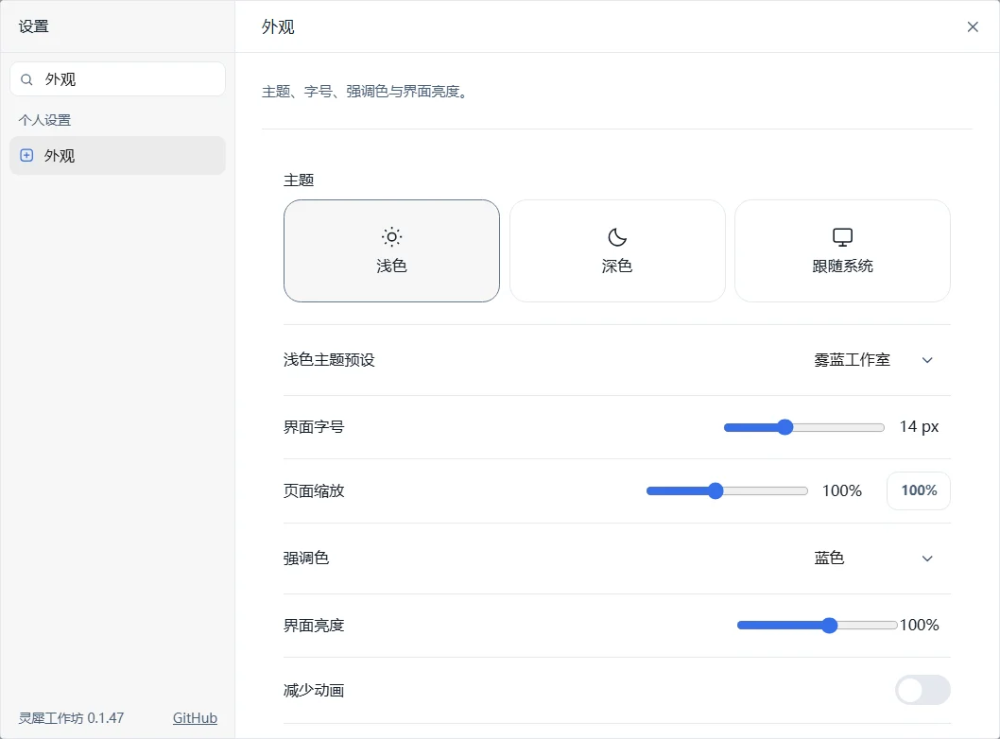
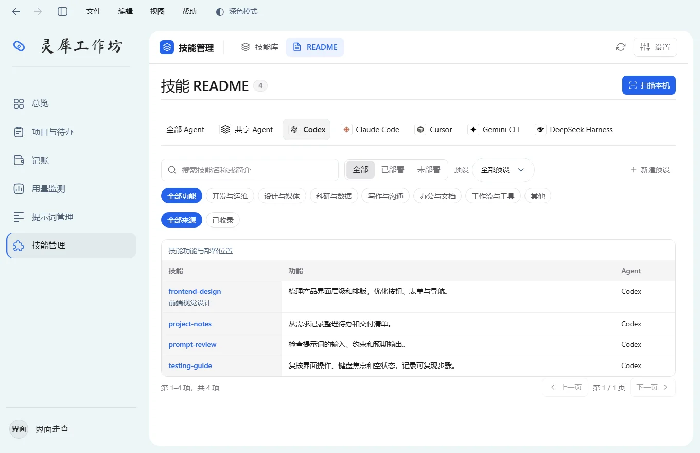
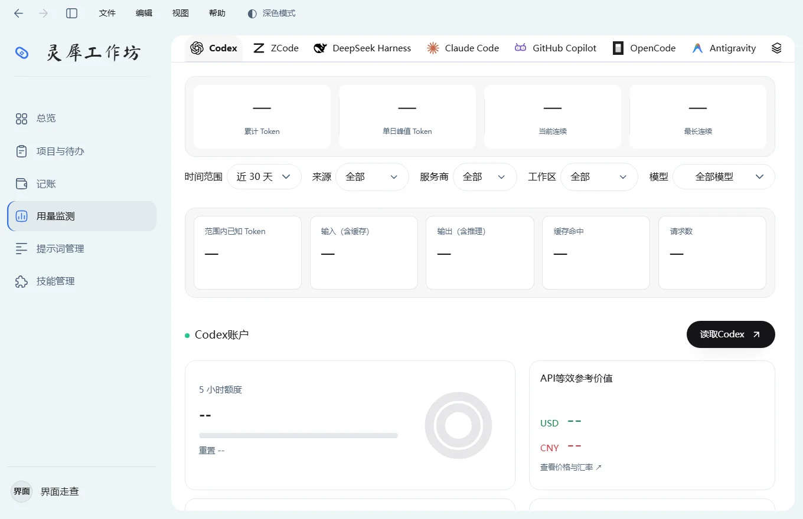
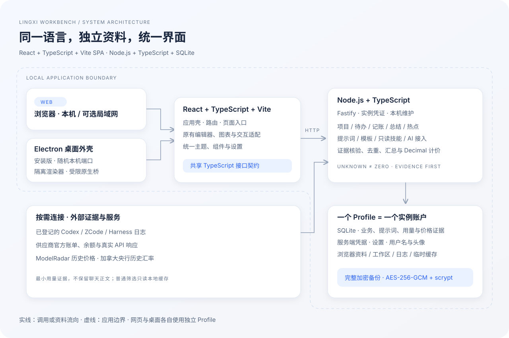

<div align="center">

<br>**灵犀工作坊**

<h3>在一个工作台里安排工作、管理提示词，并查看 AI 用量</h3>

<a href="https://github.com/Ceeyu-iooi/Lingxi-Workspace/releases"><b>下载</b></a>&emsp;<a href="#get-started">开始使用</a>&emsp;<a href="#agents">Agents</a>&emsp;<a href="#how-it-works">工作原理</a>

[](https://github.com/Ceeyu-iooi/Lingxi-Workspace/releases)
[](#get-started)
[](LICENSE)

</div>

<p align="center"><picture>
  <source media="(prefers-color-scheme: dark) and (max-width: 600px)" srcset="docs/images/workbench/overview-compact.webp">
  <source media="(prefers-color-scheme: dark)" srcset="docs/images/workbench/overview-dark.webp">
  
</picture></p>

## 用灵犀工作坊做什么

<table>
<tr>
<td width="50%" valign="top">
<br>
<b>安排一周的工作</b><br>
从总览查看近期待办，按项目和状态整理事项，在列表与甘特图之间切换。
</td>
<td width="50%" valign="top">
<br>
<b>管理本机工作台</b><br>
设置主题、字号、快捷键、用量来源和 AI 服务，在数据设置中备份或迁移 Profile。
</td>
</tr>
<tr>
<td width="50%" valign="top">
<br>
<b>查看每个技能的用途</b><br>
按 Agent 筛选索引，在 README 表格查看技能说明与部署位置，按需打开原文。
</td>
<td width="50%" valign="top">
<br>
<b>核对用量和花费</b><br>
查看可核验的 Token、缓存和费用，按来源、模型与时间筛选。记账支持账单导入预览、分类与趋势。
</td>
</tr>
</table>

<a id="get-started"></a>

## 开始使用

**Windows x64** · 从 [Releases](https://github.com/Ceeyu-iooi/Lingxi-Workspace/releases) 下载并运行 `Lingxi-Workbench-版本-x64-Setup.exe`。桌面版自带 Electron 运行时。

**本机网页版** · 下载公开源码，使用 Node.js 24 LTS。

```sh
npm ci
npm run build:web
npm start
```

打开 [127.0.0.1:8765](http://127.0.0.1:8765/)。Windows 也可运行 `start.bat`。

首次启动选择或创建 Profile 并填写用户名。用量监测与 AI 服务可按需连接。

<details>
<summary><b>更新、局域网和资料位置</b></summary>

- 桌面版可从「设置 → 关于」检查更新。下载和安装由用户确认，可用发布页的 SHA-256 校验安装包。
- 网页默认监听本机。需要局域网访问时，在「数据与备份」配置监听范围和连接凭证，保存后重启网页后台。
- 网页和桌面 Profile 分开保存，默认目录名为 `profile`。备份、恢复和迁移从「数据与备份」进入。

</details>

<a id="agents"></a>

## Agents 与 AI 服务

| 用途 | 操作 |
| --- | --- |
| 本机用量 | 在用量设置中登记 Codex、ZCode、DeepSeek Harness 等来源，查看可读取的日志历史 |
| 供应商账户 | 按需配置 API Key，查询供应商实际提供的余额、费用或用量 |
| 技能索引 | 查看共享 Agent、Codex、Claude Code、Cursor、Gemini CLI 等已登记目录，按 Agent 浏览功能 |
| 提示词 | 导入、编辑、收藏、管理版本和模板，按需使用已配置模型评估或优化 |

<a id="how-it-works"></a>

## 工作原理

<p align="center"></p>

主应用使用 React 和 TypeScript，Git 时间轴独立使用 Semanote-Agent 的 Vue 组件。Node.js 后端通过 SQLite 管理 Profile、提示词、用量和记账数据。桌面版使用 Electron。 [架构与资料流](ARCHITECTURE.md) · [用量口径](TOKEN_ACCOUNTING.md)

## 隐私

技能扫描只读取已登记目录。AI 评估、优化和识别只在用户触发时向已配置服务发送所需输入。凭据留在服务端 Profile，完整备份使用用户设定的口令加密。

## 贡献与许可

[提交反馈](https://github.com/Ceeyu-iooi/Lingxi-Workspace/issues) · [设计规范](DESIGN.md) · [第三方声明](THIRD_PARTY_NOTICES.md) · [许可证](LICENSE)

时间轴、设置界面和 README 结构参考了 [Semanote-Agent](https://github.com/Ceeyu-iooi/Semanote-Agent) 与 [Papilot](https://github.com/PapilotAI/papilot)。
