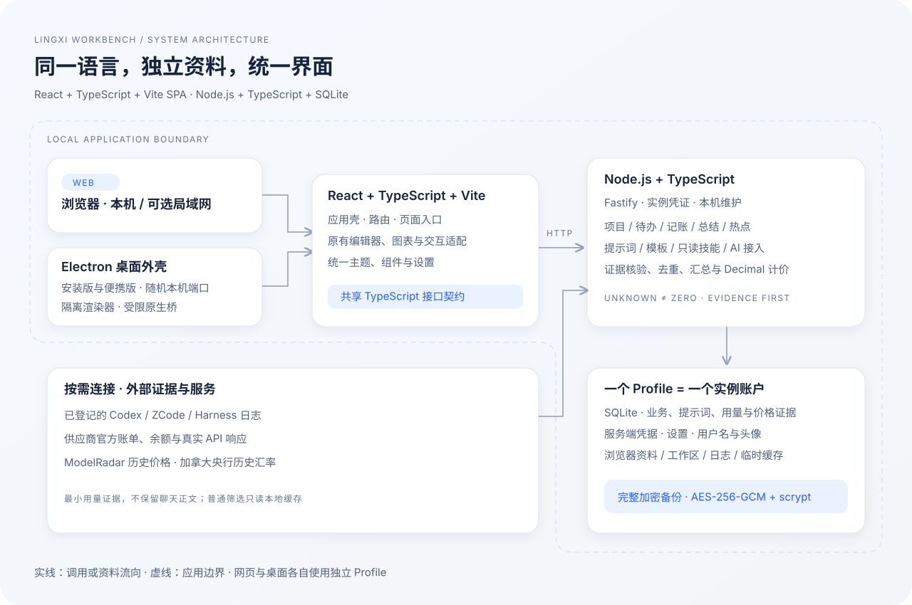

# 架构与资料流

前端以 React + TypeScript + Vite 构建 SPA，React 管理应用壳、路由和页面入口。`frontend/compat` 保存原有图表、编辑器与 DOM 交互适配，保留已经使用验证的行为；这些适配目前未全面开启严格类型检查。新页面入口、共享契约和 Node 后端通过严格 TypeScript 检查。应用内集成的第三方组件成品继续复用，不公开付费原源码或源码映射。

`scripts/web_launcher.mjs` 定位工程、启动自有 Node 子进程、核验版本/PID/Profile/service 身份、处理正常退出和受控资料迁移，不依赖终端当前目录。`src/server/main.ts` 用 Fastify 提供 HTTP 路由和构建后的页面资源，`src/shared` 保存共享接口。服务端模块覆盖业务、提示词、市场、技能、供应商适配、日志采集、证据汇总、历史计价与备份。

Profile 是唯一资料身份，用户名可改，profileId 不随改名变化。应用不再提供注册、登录、密码与退出登录。局域网是否要求实例凭证由当前 Profile 配置决定；profileId 不是访问凭据，维护接口仍限制本机操作。默认只监听回环地址。

业务、用量、读取进度、原始最小证据和计价缓存集中于 SQLite；凭据位于 Profile 的服务端资料目录。Token 未知值与零分别保存，int64 数量精确存储，Decimal 计算金额。价格证据按摘要寻址、无损压缩，读取核验长度和摘要。普通筛选查询本地索引与 8 MiB 响应缓存，不反复请求价格网络。

加密备份包括 Profile 身份、用户名、头像、业务库、设置、凭据与工作区，排除更新包、日志、浏览器临时缓存和备份自身。数据库采用一致性备份；恢复先验证 AES-GCM、摘要与路径，制作加密预备份，再暂存应用，失败回滚。迁移先停止自有服务、取得写入锁、一致性复制、核验文件及数据库，然后原子切换定位。旧副本仅在用户确认后删除摘要未变化的文件。

Electron 渲染器关闭 Node 集成，启用 contextIsolation 与 sandbox。主进程只允许可信主 frame 使用资料选择、窗口主题和手动更新桥。桌面在独立 utilityProcess 中复用 Electron 自带 Node，不额外附带 Node.exe；网页仍用 Node 24。SQLite 使用运行时内置 node:sqlite，头像编解码在受限且串行的工作线程内完成。安装版定位到程序旁或显式选择的Profile。便携版构建、验收和发布已永久取消；旧客户端兼容读取不得把真实资料写入临时解包目录。

图的层次、边界和带说明的箭头参考 [C4 容器图](https://c4model.com/diagrams/container)，图形、布局和内容为本项目自绘。

## 增量计算与稳定界面

消费及证据修改进入稀疏计价队列；历史价格影响消费 UTC 日期及相邻边界，汇率影响其实际沿用窗口。金额保留精确分项和证据引用。每日汇总按来源、模型、服务商、工作区和连接维度维护，仅重建脏日期；原始消费和证据保持权威。原始记录详情按需读取，默认最多 100 条。

额度请求与参考价值摘要分开。摘要返回 USD/CNY，开关读取缓存，显式刷新才联网；未知 / 失败不移除组件。日期格式化器复用，避免逐条创建 ICU 对象。组件在离开页面时释放观察器、计时器和脱离文档的 React 根。

六套侧栏与强调色主题的浅深配色在 `src/shared/theme-presets.ts` 中维护；跨页面外观消息按 profileId 隔离。页面缩放使用共享内容层，不与字号设置叠加。DeepSeek授权只在点击获取时复用现有Electron官方临时窗口，完成后关闭本次连接；服务端只保存匹配 Key 所需的平台凭据，不记录密码、页面正文或网络请求原文。

## 运行资源与浏览器授权

资源统计以进程实测值和模块缓存估算分别呈现，缓存不与进程内存相加；没有为每个页面增加独立进程。响应缓存8MiB，4KiB以上响应仅在轻量压缩节约至少30%时压缩，解压限制原始长度，容量包含键和每项估计开销；每次读取仍返回独立对象及精确整数。同版本筛选复用派生数据集，失效后重新读取。计价与解压缓存保持有界；后台供应商自动同步最多并发两个，按最久未尝试的Key顺序执行，避免遗漏。

DeepSeek授权复用现有Electron的官方临时登录窗口；独立内存会话禁用HTTP磁盘缓存，不加载应用preload。受限主进程桥持有内部一次性授权任务，后端核验Profile、账户与Key归属。完成、取消、超时或资料切换释放会话和监听；无需扩展、调试端口或新增浏览器。网页复用有效授权，新历史授权在桌面版完成。

资源窗口可见时使用单个每秒调度器；存储进入自动扫描，快照以Profile和扫描身份隔离，通过有界文件/目录变化检查刷新。原生更新缓存在首页显示就绪回执后清理。

## 桌面悬浮窗

悬浮窗使用独立React/Vite入口和受限preload，不加载完整工作台控制器。额度解析和图表渲染复用既有实现；主进程仅代理允许的只读用量请求，视图缓存有界，Profile配置独立保存。Win32事件辅助程序按需判断同屏全屏状态，不截图或读取窗口标题。

主窗进入轻量模式前，复用模块快照保存草稿与业务编辑身份，保存路由、筛选和滚动后销毁渲染器；后台与悬浮窗继续运行。不能安全恢复的编辑保持主窗并给出提示。恢复不播放冷启动Logo。原生材质和窗口行为与网页视觉分别验证。
